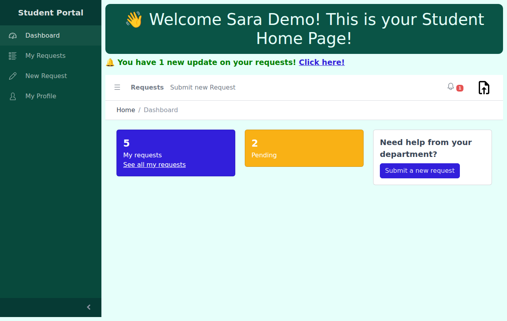

# Student Request Portal

[](https://github.com/maryam843/student-request-portal/actions/workflows/ci.yml)

A web portal in Node.js, Express and MongoDB: students send requests to their Head of Department, who reviews category queues and approves or rejects them with a note.

## Key results

- 75 automated tests in 12 files, all passing on GitHub Actions, which also runs a dependency audit and ESLint on every push.
- Two decisions sent on the same request at the same moment: only one is saved, the other gets HTTP 409.
- From one address, the 11th wrong login within 15 minutes is refused with HTTP 429.
- A password reset logs the user out on every browser.

## Screenshots

| Student dashboard | Head of Department dashboard |
|---|---|
|  |  |

**Tools:** Node.js, Express, MongoDB, Handlebars, bcrypt, helmet, csrf-sync, Multer, node:test, supertest, ESLint, GitHub Actions

## Data

There is no external dataset. The app stores three MongoDB collections: `users`, `requests` and `sessions`.

- **Source:** [scripts/seed.js](scripts/seed.js) creates made-up demo data (names ending in "Demo", `@example.com` e-mails).
- **Size:** 4 users (1 Head of Department, 3 students) and 15 requests (7 pending, 4 approved, 2 rejected, 2 cancelled).
- **Licence:** not applicable, no third-party data.
- **Why it is not in the repo:** it is generated on each run, so only the script is committed. Real `.env` files and uploaded pictures are ignored by git.
- **How to get it:** `npm run demo` and the tests create it automatically in an in-memory MongoDB; `npm run seed` writes it to your own MongoDB.

## Approach

1. **Three layers:** `app.js` (security middleware and routes), `business.js` (rules) and `persistence.js` (MongoDB queries), with server-rendered Handlebars pages.
2. **Two roles:** sessions are stored in MongoDB and renewed at login; every page checks the role, and a student can only open their own requests.
3. **Request flow:** a request joins its category queue and gets a rule-based estimated completion time: 15 minutes for each request already waiting, counted 9am to 5pm Qatar time, Sunday to Thursday. It is computed in `Asia/Qatar` explicitly, so the result is the same on any server time zone.
4. **One-step decisions:** the Head of Department's decision is a single MongoDB update filtered on `status: "Pending"`. The first version checked and then updated in two steps, so a request cancelled at the same moment could still be approved.
5. **Account security:** bcrypt passwords (at least 8 characters), a CSRF token on every form, a Content Security Policy with no inline scripts, and reset and verification links stored only as SHA-256 hashes that expire and work once. A reset now deletes every session of that user; the first fix for this crashed the server when the reset happened in the browser that was logged in, and the reset route now ends its own session first.
6. **Uploads:** profile pictures must be JPG, PNG or WEBP up to 2 MB, and the first bytes must match the type. A text file named `x.png` was accepted before this check; now it is rejected and deleted.
7. **Input and accounts:** form and link values are forced to plain text and checked against fixed lists; registering with an e-mail that already has an account gets the same answer as a new one, and the owner is e-mailed instead.
8. **Checks:** integration tests run through the real HTTP stack (supertest) against an in-memory MongoDB with the demo data; CI runs `npm ci`, `npm audit --audit-level=high`, `npm run lint` and `npm test` on Node 22.

## Results

Each row is a behaviour check from the test suite, compared with what happens without the protection.

| Check | Result | Without the protection |
|---|---|---|
| Automated tests | 75 pass of 75, 0 fail, 0 skipped | n/a |
| Two decisions on one request at once | 1 saved (302), 1 refused (409) | both saved, the last one wins |
| Wrong logins from one address in 15 minutes | 302 for tries 1 to 10, then 429 | unlimited password guessing |
| Older sessions after a password reset | 302 to `/login` | a stolen session keeps working |
| Text file named `x.png` uploaded as a picture | rejected and deleted | stored as a picture |
| Student opens a Head of Department page / another student's request | 403 / 404 | other users' data visible |
| Estimate under 4 server time zones | identical | shifts with the server's clock |
| `npm audit --audit-level=high` | passes: 0 high or critical, 1 moderate (hbs, no fixed version exists) | n/a |
| ESLint, recommended rules | 0 problems | n/a |

## Limitations

- Not deployed, and no real e-mail is sent: verification and reset links are printed in the server console.
- One Head of Department account sees the requests of all colleges, and there is no audit trail of who decided a request and when.
- The login rate limit is per IP address and kept in memory, so it resets on restart and one shared address can lock out many users.
- The estimate is a fixed rule set once at submit time and ignores public holidays; one moderate hbs advisory has no fixed version yet.
- The tests do not measure code coverage, load or real e-mail delivery.

## How to run

Needs Node.js 22 or newer. The first run downloads a MongoDB binary (about 86 MB), so it needs an internet connection.

```bash
npm ci
npm run demo
```

`npm run demo` starts an in-memory MongoDB, adds the demo data and serves the app on http://localhost:8000, with no `.env` needed. Press Ctrl+C to stop; the demo data is deleted.

Demo logins (made-up accounts, password `Demo@1234` for all):

| Role | Email |
|---|---|
| Head of Department | hod@example.com |
| Student | sara@example.com |
| Student | omar@example.com |
| Student | lina@example.com |

Lint and tests, as CI runs them:

```bash
npm run lint
npm test
```

With your own MongoDB: copy `.env.example` to `.env` and fill in `MONGODB_URI` and `SESSION_SECRET`, then:

```bash
npm run seed   # deletes all users, requests and sessions in that database first
npm start
```

## Repo structure

```text
app.js                     Express app: security middleware, sessions, CSRF, uploads, routes, error handler
business.js                rules: registration, login, tokens, password reset, estimate, decisions
persistence.js             MongoDB access: indexes, queries, one-step decision, counts and queues
scripts/seed.js            demo data: 4 users, 15 requests
scripts/demo.js            one-command demo with an in-memory MongoDB
views/                     14 Handlebars pages and 2 layouts
public/                    own CSS and client script, CoreUI files under css/style.css and vendors/
test/                      12 test files and helpers.js
docs/screenshots/          the two screenshots above
eslint.config.js           ESLint configuration
.github/workflows/ci.yml   CI: install, audit, lint, test
.env.example               settings the app reads
LICENSE                    MIT licence for my own code
THIRD_PARTY_NOTICES.md     CoreUI credits and the files they cover
```

## Licence and credits

My own code is under the MIT licence ([LICENSE](LICENSE)). The page layout and styles are based on the CoreUI Free Bootstrap Admin Template 4 (MIT), and the icon sprite is from CoreUI Icons Free (CC BY 4.0); these files keep their own licences, listed in [THIRD_PARTY_NOTICES.md](THIRD_PARTY_NOTICES.md). The demo data is made up and needs no citation.
