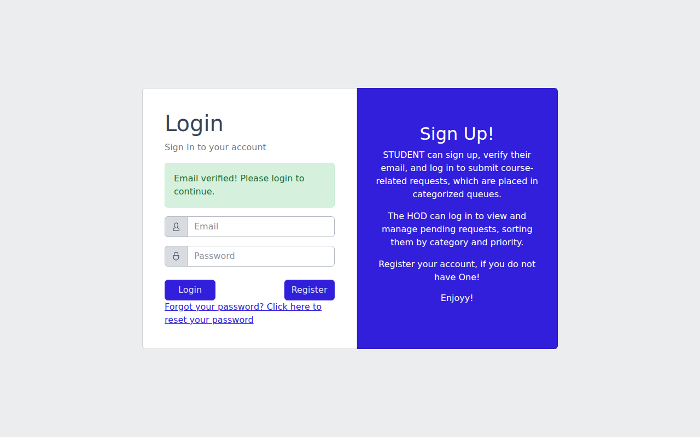
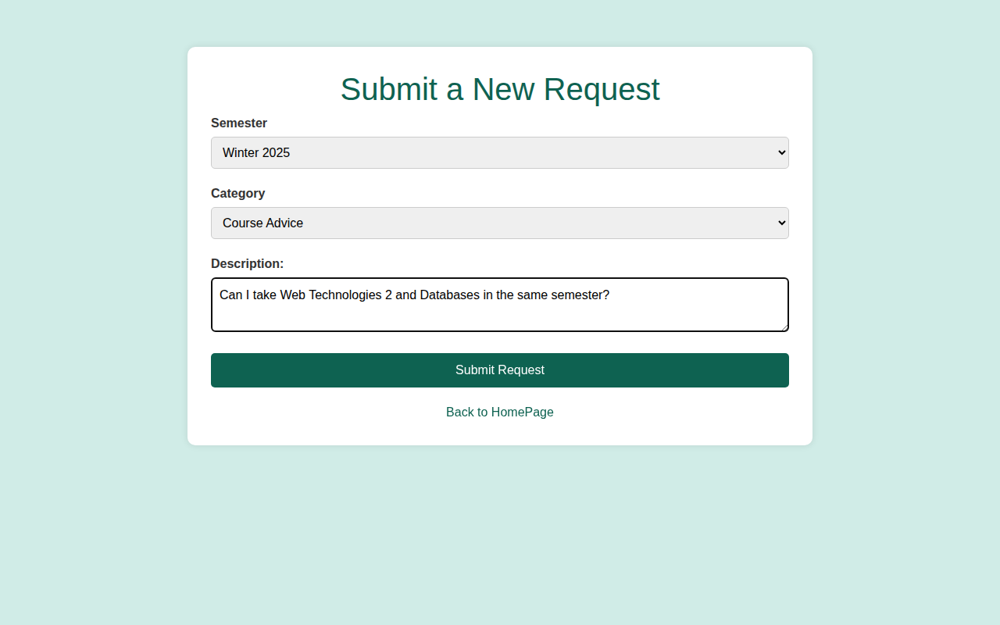
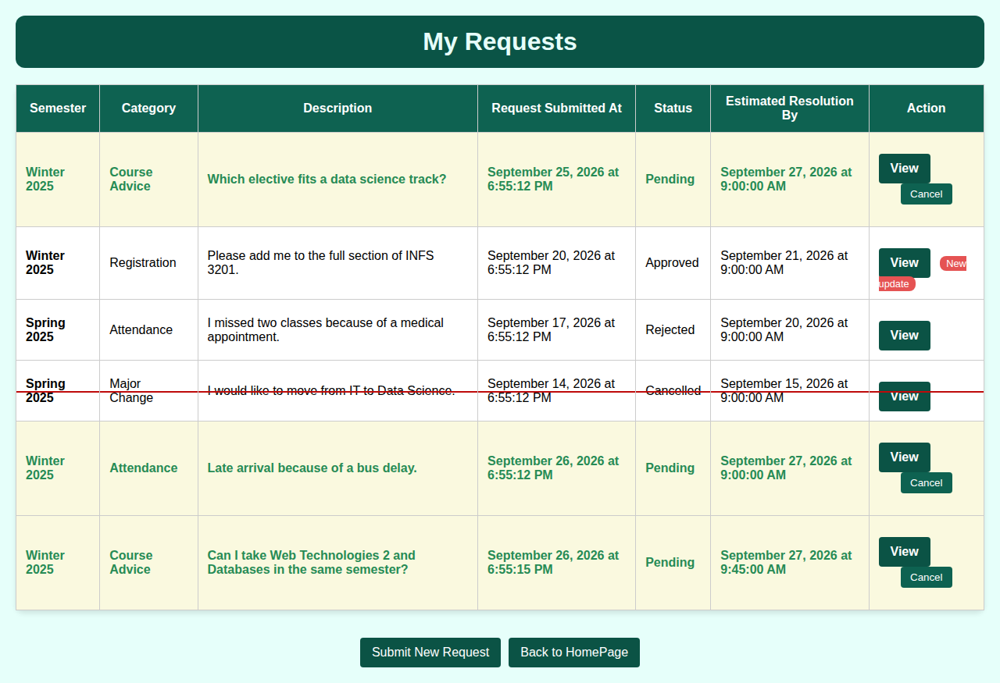

# Student Request Portal

A web app where students send requests (course advice, attendance, registration, major change) to their Head of Department, who reviews them in category queues and approves or rejects them.

## Screenshots

| Login | Student dashboard |
|---|---|
|  |  |

| New request | My requests |
|---|---|
|  |  |

| HoD dashboard | HoD request list |
|---|---|
|  |  |

| HoD decision |
|---|
|  |

## Features

### Student
- Register a student account with a profile picture, then verify the email with a link (demo: the link is printed in the server console, no real email is sent)
- Log in and log out
- Submit a request with a semester, category and description; each request gets an estimated completion time
- See all own requests, open one to read the Head of Department's note, and cancel requests that are still pending
- A badge on the dashboard shows how many requests have a new decision that has not been opened yet
- Profile page with the account details and a form to change the profile picture
- Forgot / reset password (demo: the reset link is printed in the server console)

### Head of Department
- Dashboard with the number of pending, approved and rejected requests
- List of all requests, with filters by category and semester
- Queue summary per category (pending out of total), built with a MongoDB aggregation
- Queue page per category, oldest request first
- "I don't know where to begin!" opens a random pending request
- Approve or reject a pending request with a note

## Tech stack
- Node.js and Express
- MongoDB (official `mongodb` driver)
- Handlebars views (`hbs`)
- CoreUI 4 admin template (Bootstrap 5)
- express-session + connect-mongo for login sessions, bcrypt for passwords, Multer for uploads

The code is split into three files: `app.js` (routes), `business.js` (logic) and `persistence.js` (database).

## How to run

You need Node.js 18 or newer and a MongoDB server running locally.

```bash
cp .env.example .env      # then set SESSION_SECRET to a long random string
npm install
npm run seed              # WARNING: deletes all users, requests and sessions in that database
npm start                 # or: npm run dev (restarts on file changes)
```

Open http://localhost:8000.

## Demo logins

Created by `npm run seed`. The password for all of them is `Demo@1234`.

| Role | Email |
|---|---|
| Head of Department | hod@example.com |
| Student | sara@example.com |
| Student | omar@example.com |
| Student | lina@example.com |

New accounts made on the register page are always students.

## How the ETA works

When a student submits a request, the app counts the pending requests in the same category and allows 15 minutes for each one. It then counts those minutes forward from the submission time, but only inside working hours: 9am to 5pm, Sunday to Thursday (Friday and Saturday are the Qatar weekend). A request sent outside working hours starts counting at the next working time. The server's local time is used.

## Security fixes made in 2026
- The database connection string was hard-coded in the source; it now comes from a `.env` file that is not committed
- Only the `public/` folder is served, so the server code can no longer be downloaded
- Real login sessions instead of `?email=` in the URL, plus a check on every page: students can only see and cancel their own requests, and Head of Department pages are only for the Head of Department
- Registration always creates a student account (before, anyone could choose "Department Head")
- Real logout that deletes the session
- Passwords are hashed with bcrypt instead of SHA-256
- Uploads: only JPG, PNG, GIF or WEBP images up to 2 MB, saved under a random name
- The password reset token is no longer inserted raw into HTML
- Form and URL values must be plain text, so tricks like `?email[$ne]=` do not reach MongoDB
- IDs are checked before use and errors show an error page instead of crashing the server

## Limitations
- Emails are not sent; verification and reset links are printed in the server console
- No automated tests; the app was checked by hand
- No rate limiting on login and no CSRF tokens (the session cookie uses `SameSite=Lax`)

## Credits
Built for INFS 3201 – Web Technologies 2 at UDST (Winter 2025) on the CoreUI 4 admin template (MIT). Security fixes and bug fixes added in 2026.
