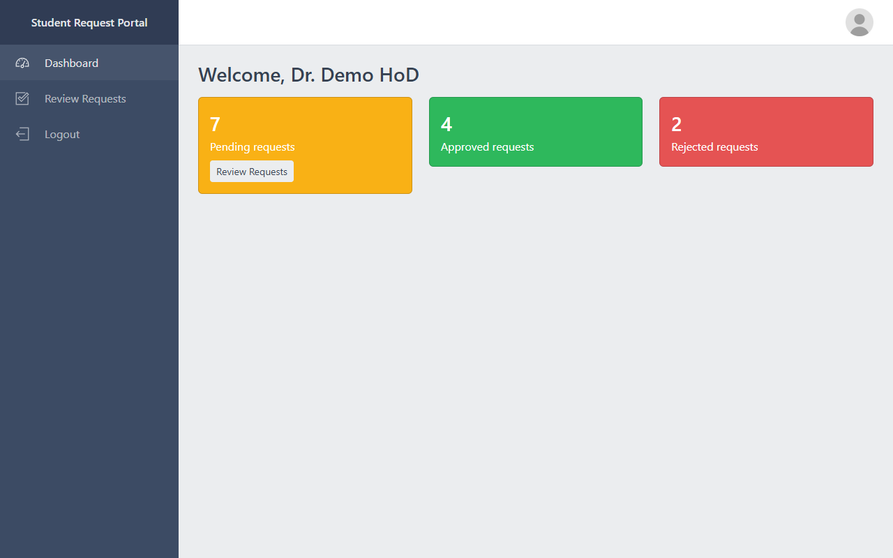
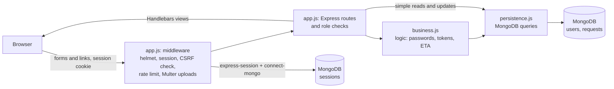

# Student Request Portal

[](https://github.com/maryam843/student-request-portal/actions/workflows/ci.yml)

This is a web app I built for INFS 3201 (Web Technologies 2) at UDST in 2025. Students send requests (course advice, attendance, registration or major change) to their Head of Department, who reviews them in queues and approves or rejects them. In 2026 I went back to it to fix security problems and clean up the code.

## Demo

<!-- demo video goes here -->

The steps I follow in the video are in [docs/DEMO_SCRIPT.md](docs/DEMO_SCRIPT.md).

| Student dashboard | Head of Department dashboard |
|---|---|
|  |  |

## Features

Student:
- Register, verify the email and log in (the verification link is printed in the server console)
- Submit a request. It gets an estimated completion time: 15 minutes for every request already waiting in the same category, counted only from 9am to 5pm, Sunday to Thursday
- See my requests, open one to read the Head of Department's note, and cancel requests that are still pending
- A badge shows decisions I have not opened yet
- Profile page where I can change my picture (users without one get a grey default avatar)
- Forgot / reset password (the reset link is printed in the server console)

Head of Department:
- Dashboard with the number of pending, approved and rejected requests
- List of all requests, newest first, with filters by category, semester and status
- A queue for each category, and a button that picks a random pending request
- Approve or reject a request with a note

Both roles:
- The same left menu on every page after login, with the open page highlighted; on a phone it opens from the menu button
- Detail pages have a "Back to ..." link, and a short message confirms each action (for example "Request submitted.")

## Tech stack

Node.js, Express, MongoDB, Handlebars and the CoreUI 4 admin template (Bootstrap 5). I also use express-session for logins, bcrypt for passwords, Multer for uploads, express-rate-limit, helmet for the security headers and csrf-sync for the CSRF tokens. The code is in three files: `app.js` (routes), `business.js` (logic) and `persistence.js` (database).



## How to run

You only need Node.js 18 or newer.

```bash
npm install
npm run demo
```

Then open http://localhost:8000. `npm run demo` starts a temporary MongoDB in memory, adds demo data and starts the app, so you do not need to install MongoDB or create a `.env` file. The first time, it downloads MongoDB, so it needs an internet connection and can take a minute. Press Ctrl+C to stop it; the demo data is deleted.

Demo logins (made-up accounts; the password for all of them is `Demo@1234`):

| Role | Email |
|---|---|
| Head of Department | hod@example.com |
| Student | sara@example.com |
| Student | omar@example.com |
| Student | lina@example.com |

The normal way, with your own MongoDB:

```bash
npm install
cp .env.example .env    # Windows: copy .env.example .env; then fill in MONGODB_URI and SESSION_SECRET (BASE_URL and NODE_ENV are optional)
npm run seed            # adds the demo data (deletes the users and requests in that database)
npm start
```

## Tests

```bash
npm test
```

The tests use Node's built-in test runner (`node:test`), supertest and an in-memory MongoDB with the demo data, so they do not touch a real database. The first run downloads MongoDB (about 100 MB). They need Node.js 20.10 or newer on Windows, Linux or macOS (GitHub Actions runs them on Node 20 for every push and pull request). `npm test` lists the test files by name, so it does not depend on the shell, and runs them one after another because they share the `uploads/` folder.

On 3 October 2026 there were 62 tests in 11 files, and all of them passed. They cover:

- the estimated completion time (working hours, weekend, before 9am, long queue), in Qatar time
- login, wrong password, unverified account, logout, and a new session id after login
- access rules: students and the Head of Department only see their own pages, a student cannot open or cancel another student's request, and a bad id gives 404
- uploads: only JPG/PNG/GIF/WEBP up to 2 MB; unused files are deleted
- security headers (CSP, no framing), no inline scripts on any page, CSRF tokens on every form
- password length, reset and verification links (hashed, expire, work once), and the production cookie settings
- approving or rejecting a request that was cancelled at the same time

## What I fixed in 2026

- Moved the database password out of the code into a `.env` file and removed it from the git history
- The server now only shares the `public/` folder, not the whole project
- Real login sessions and a role check on every page, instead of the email in the URL
- New accounts are always students
- Passwords are hashed with bcrypt instead of SHA-256
- Uploads: only images, up to 2 MB
- Form and URL values must be plain text, and a bad link shows an error page instead of crashing the server
- Login, register and forgot password are limited to 10 tries per 15 minutes
- A unique index on the user email in MongoDB
- Fixed the password reset, the login messages, broken HTML and the made-up numbers on the Head of Department dashboard
- Removed personal fields I did not need (date of birth, ID, nationality, address, phone)
- Removed the unused template pages, demo content and code
- Added automated tests, and fixed the problems in the table below

I used Claude Code as an AI assistant to help audit and refactor the code; I reviewed and understand every change.

### Security audit: before and after

| 2025 flaw | Risk | 2026 fix | Commit |
|---|---|---|---|
| No security headers | An injected script could run; another site could show the app in a frame and trick users into clicking (clickjacking) | helmet with a Content Security Policy (scripts only from this server) and `frame-ancestors 'none'`; the two inline scripts moved to `public/js/app.js` | [7ca8413](https://github.com/maryam843/student-request-portal/commit/7ca8413) |
| No CSRF tokens (only `SameSite=Lax`) | Another website could send a form (cancel, approve, logout) with the user's login cookie | A CSRF token in every POST form (csrf-sync); without it the server answers 403 | [51b3d63](https://github.com/maryam843/student-request-portal/commit/51b3d63) |
| Any password length accepted | Very short passwords are easy to guess | At least 8 characters, checked on the server when registering and resetting | [65d7738](https://github.com/maryam843/student-request-portal/commit/65d7738) |
| The HoD decision checked "Pending" and then updated in two steps | A request the student cancelled at the same moment could still become Approved | One update with the filter `{_id, status: "Pending"}`; otherwise "already cancelled or decided" | [91b162b](https://github.com/maryam843/student-request-portal/commit/91b162b) |
| Reset tokens stored as plain text; verification links never expired | Anyone who can read the database could reset passwords; old verification links worked forever | Only the SHA-256 hash of a reset token is stored; verification links expire after 24 hours; both work once | [420f660](https://github.com/maryam843/student-request-portal/commit/420f660) |
| Login cookie never marked `Secure`; verification link hard-coded to `localhost:8000` | On a real HTTPS server the cookie could be sent over plain HTTP; links pointed to the wrong address | In production: `Secure` cookie and `trust proxy`; both links use `BASE_URL` (or `PORT`) | [e4b1f58](https://github.com/maryam843/student-request-portal/commit/e4b1f58) |
| Uploaded files left behind; college and semester lists not checked properly | `uploads/` fills with unused files; any college value could be saved; the semester list stopped at 2025 | Unused pictures are deleted, the college is checked against the list, semesters come from the current year | [72172ff](https://github.com/maryam843/student-request-portal/commit/72172ff) |
| No automated tests | Changes could break login or access rules without anyone noticing | 62 tests and GitHub Actions on every push | [4cd6783](https://github.com/maryam843/student-request-portal/commit/4cd6783), [6b1f66b](https://github.com/maryam843/student-request-portal/commit/6b1f66b) |

## Limitations

- No real emails are sent; the links are printed in the server console
- The app is not deployed; it runs on my computer
- Times use the server's local time
- The estimated completion time skips weekends but not public holidays
- There is one Head of Department account, and it sees the requests of all colleges

## Future work

- An audit trail of decisions: who approved or rejected a request, and when
- Department scoping, so each Head of Department only sees the requests of their own college
- Database indexes on the requests (studentEmail, and category with status)
- Sending real emails
- Deploying the app

## Credits

Solo project, originally built for INFS 3201 Web Technologies 2, UDST, Winter 2025; fixed and extended in 2026. It is built on the CoreUI 4 admin template (MIT).

My code is under the MIT License (see [LICENSE](LICENSE)); the CoreUI files keep their own MIT license.
